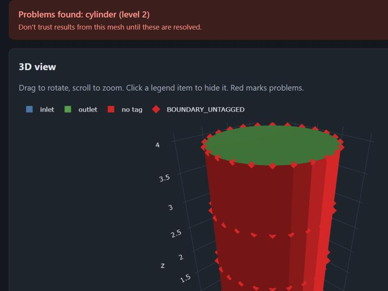

# meshpreflight

**Check a finite element mesh before you trust a simulation.**

A broken mesh doesn't always crash a solver. If a boundary label gets lost between Gmsh and your
solver, many workflows carry on and return a believable, wrong answer. In this project's own test,
losing one boundary tag made a heat calculation **213 times less accurate with no error message**.

meshpreflight looks for these silent failures before you spend hours on a solve. Tell it what should
be true about your mesh, and it reports anything that doesn't match.



```python
from meshpreflight import preflight

report = preflight("pipe.msh", {"inlet": 2, "outlet": 2, "wall": 2, "fluid": 3})
print(report.to_text())
```

```text
PROBLEMS FOUND: 2 error(s), 0 warning(s)
  [ERROR  ] TAG_MISSING: Expected tag 'wall' (dimension 2) is not in the mesh.
  [ERROR  ] BOUNDARY_UNTAGGED: 192 of 384 outer boundary pieces have no tag.
```

## What it checks

| Stage | What can go wrong | Finding codes |
|---|---|---|
| **Tags** | A boundary or region is lost, renamed, emptied, or left partly unlabelled | `TAG_MISSING`, `TAG_EMPTY`, `TAG_UNNAMED`, `TAG_WRONG_DIMENSION`, `BOUNDARY_UNTAGGED`, `BOUNDARY_NOT_TAGGED`, `DOMAIN_UNTAGGED`, `FLOATING_FACETS` |
| **Elements** | Inside-out, collapsed or extremely thin cells | `INVERTED_CELLS`, `DEGENERATE_CELLS`, `LOW_QUALITY_CELLS` |
| **Connections** | Duplicate points and cells, or separate floating pieces | `DUPLICATE_POINTS`, `DUPLICATE_CELLS`, `NONMANIFOLD_FACES`, `MULTIPLE_COMPONENTS`, `ORPHAN_POINTS` |
| **Surfaces** | Holes, faces pointing the wrong way, surfaces that are inside out | `OPEN_SURFACE`, `WINDING_INCONSISTENT`, `SURFACE_INVERTED`, `NONMANIFOLD_EDGES` |
| **Sizes and units** | Volume or tag sizes that differ from what you expected, millimetre/metre mix-ups | `MEASURE_MISMATCH`, `UNIT_SCALE_MISMATCH` |

Run `meshpreflight checks` for a plain-language explanation of each check.

## Install

Not on PyPI yet, so install it from a copy of this repository:

```bash
git clone https://github.com/Ergopeoxy/meshpreflight.git
```

```bash
cd meshpreflight
```

```bash
pip install -e ".[web]"
```

The core needs only NumPy and SciPy. The `[web]` extra adds the web interface and plots, `[viz]` adds
plots alone, and `[dev]` adds everything needed to run the tests, including Gmsh.

## Three ways to use it

**Web interface.** Upload a file, or damage a reference shape and see what gets caught. It runs on your
own computer, and files aren't saved or sent anywhere.

```bash
meshpreflight web
```

Then open <http://127.0.0.1:5000>.

**Command line.** The exit code is 1 when errors are found, so it can stop a batch job or CI pipeline.

```bash
meshpreflight check pipe.msh --expect inlet:2 --expect outlet:2 --expect wall:2 --expect fluid:3 --plot view.html
```

**Python.**

```python
from meshpreflight import Mesh, Preflight, preflight
from meshpreflight.viz import mesh_figure, quality_figure

# Sizes are optional, but they let more mistakes be caught. This form is (dimension, size).
report = preflight(
    "pipe.msh",
    {"inlet": (2, 3.14), "wall": (2, 25.1), "fluid": (3, 12.57)},
    expected_size=4.0,   # Largest extent. This is what catches unit mistakes.
    rel_tol=0.03,        # Curved shapes need some slack, because their meshes are faceted.
)

report.ok                # False if any check reported an error
report.codes             # {"TAG_MISSING", ...}, reliable for use in scripts
report.measurements.volume.trusted

mesh_figure(report.mesh, report).show()   # Interactive 3D view with problems in red

# Works with meshes from any library:
preflight(Mesh.from_arrays(vertices, triangles=faces))
```

## Why you can trust the results

A checker has to earn trust, so this one is tested against answers that don't come from its own code.
Run `meshpreflight validate`, or open the "Is this tool right?" tab in the web interface.

| Validation area | Cases | Source of the right answer |
|---|---:|---|
| Exact geometry | 16 | Formulas for box, cylinder, sphere and torus |
| Element quality | 9 | Perfect cells with known best scores |
| Defect detection | 129 | 13 defects planted on purpose, with several random seeds, must be reported |
| No false alarms | 15 | Undamaged shapes must report nothing serious |
| Convergence | 4 | Textbook error rates (below) |
| Tag demonstration | 2 | Measured effect of losing a tag |

Measured convergence on the finest pair of meshes:

| Study | Theory | Measured |
|---|---:|---:|
| Sphere volume | 2 | 2.000 |
| 2D heat problem, values | 2 | 2.000 |
| 2D heat problem, slopes | 1 | 1.000 |
| 3D heat problem, values | 2 | 1.951 |

The automated tests also read meshes produced by **real Gmsh** in both file formats, reproduce reference
values from an independent `trimesh` run, and switch checks off to confirm that the matching defects then
go unnoticed. Details are in [docs/validation.md](docs/validation.md).

## What it can't do

These limits are as important as the features:

- **"No problems found" doesn't mean the mesh is correct.** It means the checks that ran found nothing.
  Every report lists which checks were skipped and why.
- **It doesn't judge physics or accuracy.** It can't tell whether a mesh is fine enough for your problem.
  A refinement study is the way to find that out.
- **Swapping two equal-size tags goes unnoticed.** If `inlet` and `outlet` have the same area, sizes can't
  separate them. A test documents this limit.
- **Quality limits are screening defaults, not physics.** They come from this project, not from validated
  solver thresholds, and generic quality scores predict accuracy poorly. Adjust `QualityLimits` for your solver.
- **Only linear lines, triangles and tetrahedra are analysed.** Hexahedra, prisms and curved second-order
  elements are counted and reported as *not checked*.
- **Only ASCII `.msh` (versions 2.2 and 4.1) and `.stl` are read.** Binary `.msh` gets a clear error. You can
  pass arrays from other readers to `Mesh.from_arrays`, or add one with `register_reader`.
- **Self-intersecting surfaces aren't detected yet.** They are a common defect in real STL files.
- **Tested with Gmsh, not yet with other meshers or solvers.** Real-world use may reveal gaps, and issue
  reports are welcome.

## Documentation

| Read this | To learn |
|---|---|
| [docs/fem-basics.md](docs/fem-basics.md) | The ideas behind this project, assuming no meshing background |
| [docs/code-walkthrough.md](docs/code-walkthrough.md) | What every module does and how the pieces fit together |
| [docs/validation.md](docs/validation.md) | How correctness is established, and what isn't covered |
| [docs/extending.md](docs/extending.md) | How to add checks, file formats, shapes and defects |
| [examples/](examples/) | Runnable scripts |

## License

MIT. See [LICENSE](LICENSE). The only required dependencies, NumPy and SciPy, are BSD-licensed. Gmsh is GPL
with exceptions, and is used only as an optional test and example tool, so this package doesn't import or
bundle it.
