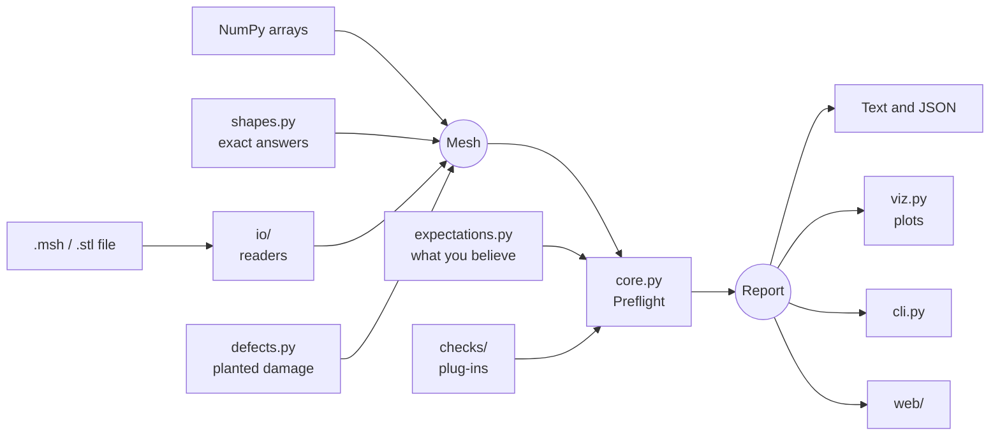

# Code walkthrough

This page explains what every part of the code does and why it's built that way. Each file also has a
header explaining its purpose, and docstrings on its classes and functions.

If mesh terms are new to you, read [fem-basics.md](fem-basics.md) first.

## The big picture



Two objects hold the design together:

- Everything that **produces** data creates a `Mesh`.
- Everything that **consumes** results reads a `Report`.

So a new file reader needs to know nothing about checks, and a new check needs to know nothing about the web
interface. The same `preflight` logic powers the Python API, command line and web interface, so they can't
disagree.

## File layout

```text
src/meshpreflight/
├── mesh.py            Mesh and CellBlock: the central data structures
├── geometry.py        Pure functions: areas, volumes, boundaries, connectivity
├── quality.py         Cell shape scores and screening limits
├── measurements.py    Sizes with a "can this be trusted?" flag; the tag table
├── expectations.py    What you state should be true
├── findings.py        Severity and Finding: the vocabulary of results
├── checks/
│   ├── base.py        Check base class, CheckContext, registration
│   ├── topology.py    How cells connect
│   ├── elements.py    Shape of each cell
│   ├── tags.py        Regions and boundary labels
│   └── scale.py       Sizes and unit mistakes
├── core.py            Preflight and preflight(): runs checks, builds the report
├── report.py          Report: text, JSON and shortcuts
├── io/
│   ├── __init__.py    load_mesh, parse_mesh and the reader registry
│   ├── msh.py         Gmsh format reader and writer
│   ├── stl.py         STL reader
│   └── errors.py      MeshFormatError
├── shapes.py          Reference shapes with exact values
├── defects.py         Deliberate damage for testing
├── solver.py          Small FEM solver for end-to-end tests
├── convergence.py     Observed order of accuracy
├── validation.py      The shared list of validation cases
├── viz.py             Plotly figures
├── cli.py             The meshpreflight command
└── web/
    ├── app.py         Flask routes
    ├── templates/     The HTML page
    └── static/        JavaScript and CSS
```

## Data

### `mesh.py`

`CellBlock` holds all cells of one kind in two matching arrays: `connectivity`, where row `i` lists the corners
of cell `i`, and `tags`, where entry `i` is that cell's tag number and `0` means untagged. Storing arrays rather
than one object per cell is what lets a million-cell mesh work, because NumPy can process a whole array at once.

`Mesh` holds points, one block per cell kind, and `tag_names`, which maps `(dimension, number)` to a name.

Things to notice:

- **`Mesh.domain`** works out what the mesh represents: `"volume"`, `"planar"`, `"surface"`, `"curve"` or `"empty"`.
  Checks depend on this, since a hole is a defect in a closed surface, while a flat 2D mesh always has an outer edge.
- **`unsupported`** counts elements the reader skipped. Without it, a mesh of hexahedra could look clean simply
  because nothing was read. This backs up the project's rule that *not checked must never look like passed*.
- **`from_arrays`** lets any library feed in data.

### `geometry.py`

Plain functions that take arrays and return arrays, with no state. Each has a textbook answer, which makes these
the easiest to test. The most important are:

- **`signed_tet_volumes`**: `det[b-a, c-a, d-a] / 6`. A negative result reveals an inside-out cell.
- **`enclosed_volume`**: forms a tetrahedron from each surface triangle to the origin and sums the signed volumes.
  Everything outside the shape cancels, but only if the surface is closed. On an open surface, the result changes
  when you move the mesh, and a test demonstrates this.
- **`boundary_rows`**: a face shared by two cells is interior, so a face that occurs once is on the outside.
- **`edge_usage`**: for each surface edge, reports how many triangles touch it and whether they agree on direction.
  Neighbours facing the same way walk a shared edge in opposite directions, so a healthy edge has a balance of zero.
- **`row_ids`**: gives identical cells the same id regardless of corner order, so `[1, 2, 3]` matches `[3, 1, 2]`.

### `quality.py`

Scores for how close each cell is to a perfect shape. Every metric has a known best value (for example, the radius
ratio of a regular tetrahedron is exactly 1), which provides an exact test. Definitions follow the Verdict manual
from Sandia National Laboratories, but the code is written independently.

`QualityLimits` holds the thresholds. They are deliberately described as screening defaults, since quality metrics
are poor at predicting accuracy, and don't amount to a statement that a mesh is safe.

### `measurements.py`

Every number here comes with a warning label. `Measurement(value, trusted, reason)` keeps a value together with
its caveat, so a report can say "4.18, not trusted: open surface". `tag_table` builds the list of tags and sizes,
including named tags with no cells, which is how an emptied tag becomes visible.

## Checks

### `checks/base.py`: the plug-in system

A check is a small class:

```python
@register_check
class MyCheck(Check):
    id = "my_check"
    title = "Human name"
    description = "What it does and why it matters."

    def skip_reason(self, ctx):        # Optional: why it can't run on this mesh
        return None

    def run(self, ctx):                # Return a list of Finding objects
        return []
```

This is the object-oriented heart of the project. `core.py` loops over checks and calls the same methods on each,
without knowing what any of them do. So adding a check means adding a class, and nothing else changes.

`CheckContext` passes the mesh, your expectations and the limits to each check. It also computes quality scores
once on first use, so several checks can share them.

`skip_reason` exists so that reports can list what wasn't checked and why.

### `checks/topology.py`

How cells connect: duplicate and unused points, repeated cells, faces shared by too many tetrahedra, holes, fins,
inconsistent winding, and separate pieces. The surface-only checks share `_SurfaceCheck`, a small base class that
provides the skip rule once.

### `checks/elements.py`

The shape of individual cells: collapsed cells, inside-out cells, inside-out surfaces and very thin cells.

One decision worth explaining: a 2D mesh where *every* triangle runs clockwise isn't an error, because it is the
same mesh viewed from the other side. Only a mix is. Clean tests and defect tests both pin this down.

### `checks/tags.py`

The most FEM-specific checks.

- **`ExpectedTags`**: compares names with your list.
- **`TagNames`**: finds tags with a number but no name.
- **`DomainCoverage`**: finds solid cells that have no region.
- **`BoundaryCoverage`**: computes the real outer boundary *from the cells*, then compares it with what's tagged.
  This one matters because it needs no input from you, and so can find a lost boundary even if you listed nothing.
- **`FloatingFacets`**: finds boundary cells that aren't attached to the domain, so that their condition acts on nothing.

### `checks/scale.py`

Compares sizes with your expectations. `recognise_unit_factor` converts a mismatch back to a length ratio
(a cube root for volumes, a square root for areas), and compares it with common unit conversions. This turns a
confusing "volume is 1e9 too large" into "lengths are about 1000 times too large (m vs mm)".

## Running

### `core.py`

`Preflight` is the reusable, configured checker, and `preflight()` is the one-call shortcut. The run itself is
short: build the context, take measurements, then for each check either record why it was skipped or run it. Findings
are sorted with the most severe first.

### `report.py`

`Report` holds the results and offers `to_text`, `to_dict`, `to_json`, `ok`, `codes`, `errors` and `warnings`.

Its status is `"errors"`, `"warnings"` or `"no_problems_found"`. There is deliberately no `"valid"` or `"passed"`,
since no tool can know that a mesh is correct.

## Reading files

### `io/__init__.py`

`READERS` maps a file extension to a function that turns bytes into a `Mesh`. Readers take bytes rather than paths,
so uploads can be parsed from memory, and nothing needs to be written to disk.

### `io/msh.py`

Reads Gmsh's text format in versions 2.2 and 4.1. The file is first split into `$Section` blocks.

- **2.2:** each element line holds its own tags, and the first tag is the physical group.
- **4.1:** elements are grouped by geometric entity. The `$Entities` section says which physical groups each entity
  belongs to, so the reader looks tags up from there.

`_CellCollector` is shared by both versions. It gathers cells, counts unsupported types, and converts the file's
arbitrary node numbers to array positions. Tests confirm this against files written by real Gmsh in both formats.

Why not use meshio? The research behind this project found no release since January 2024 and an unmerged NumPy 2 fix.
These two formats need little code, and controlling the reader lets it count what it skips.

### `io/stl.py`

STL stores each triangle's corners separately, so `merge_vertices` joins matching corners. Otherwise every triangle
would appear disconnected and the mesh would look full of holes. The file type is decided by its exact size, since
many binary files also start with the word `solid`.

## Testing machinery

### `shapes.py`

`ReferenceShape` is the base class for shapes that know their own right answers. Each provides `exact` (from a formula),
`mesh(level)`, `tolerance(level)` and `expectations(level)`.

`_extrude` builds solids by stacking a 2D mesh and cutting each wedge into three tetrahedra. Neighbouring wedges must
cut their shared side the same way or the mesh gets cracks. The rule used depends only on point numbers, so both
neighbours always make the same choice.

Flat-sided shapes are exact at every level, so they get a tiny tolerance. Curved shapes get one that shrinks as they
are refined.

### `defects.py`

Each `Defect` knows how to damage a mesh and which finding codes must then appear. The damage always happens on a copy
and uses a seeded random generator, so failures can be reproduced.

### `solver.py`

A small FEM solver for Poisson's equation (steady heat flow). It isn't meant to replace a real FEM package. It proves
the shapes, tags and sizes work together in a real calculation, and it measures the harm a lost tag causes.

`_element_geometry` computes each cell's size and shape-function gradients. `solve_poisson` assembles the cells'
contributions into one sparse matrix, fixes the boundary values and solves. It ignores missing tag names on purpose,
to behave like a typical workflow that quietly loses a boundary.

`ManufacturedProblem` provides a problem with a known exact answer.

### `convergence.py`

Measures the observed order of accuracy, `p = log(e1 / e2) / log(h1 / h2)`, for geometry or for solver errors.

### `validation.py`

One list of cases, used by the tests, the command line and the web interface, so they can't disagree. See
[validation.md](validation.md).

## Interfaces

### `viz.py`

Builds Plotly figures: the 3D mesh, quality histogram, tag sizes and a convergence plot. Plotly is imported inside the
functions, so the core library works without it. Each tag gets its own legend entry, which can be clicked to hide it.
Unlabelled boundary pieces and problems are red, a colour reserved for that purpose.

### `cli.py`

One small function per subcommand. The exit code is `0` when no errors are found, `1` when errors are found, and `2`
when it couldn't run at all (such as a damaged file), so scripts can tell these cases apart.

### `web/app.py`

The routes contain no mesh logic, and only translate between HTTP and the library.

Safety measures:

- It listens only on your own computer by default.
- Uploads are parsed in memory, never saved or executed, and capped at 256 MB.
- Refinement level is limited, so a request can't exhaust the machine.

### `web/static/app.js`

Collects input, calls the routes and draws the results. Anything from an uploaded file, such as a tag name, is only
ever inserted with `textContent`, so a crafted file can't run a script in the page. Plotly's JavaScript comes from the
Python package instead of an external site, so the page works offline.
